# Mike Singleton’s Lords of Midnight — Manual

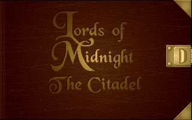

Mike Singleton’s

Lords of  
Midnight

Manual

[INNER PAGES]

Domark Presents

A Maelstrom Games Ltd Production

Mike Singleton’s

Lords of  
Midnight

The Lords of Midnight (Computer Game) Copyright 1984

Mike Singleton. All Rights Reserved.

Doomdark’s Revenge (Computer Game) Copyright 1984

Mike Singleton. All Rights Reserved.

The Lords of Midnight III – The Citadel (Computer Game) Copyright 1995

Domark Software Ltd.

The Lords of Midnight stories and characters

Copyright 1984 – 1995 Mike Singleton. All Rights Reserved.

The Lords of Midnight Computer Software, Techniques, Utilities and Engines

Copyright 1990 – 1995 Maelstrom Games

## Contents

- **Foreword**
- **Guide To Play**
  - Reference Card
  - Introduction
  - Winning & Losing
  - The Books of the Blood March
  - Saving & Restoring
  - The Hand
- **The Index Page**
  - The blue bookmark
  - The green bookmark
  - Dates & Seasons
  - Link the new book to your world’s time
  - The red bookmark
  - Page symbols
- **The Almanac & Bestiary**
- **The Map**
  - How to get from A to B
- **Heroes & Villains**
  - New Faces
  - Making new quests
  - Go to somewhere
  - Guard somewhere
  - Seize Stronghold
  - Find something
  - Attack someone
  - Join someone
  - Recruit someone
  - Destroy something
  - Rescue someone
  - Shadowing someone
  - Wait
  - Recruiting warriors
  - Warrior races
  - Warrior numbers
  - Becoming a character
  - Go to Fellowship
- **Travellers Guide**
- **Here & Now**
  - Direct control
  - Methods of Transport
  - (i) On foot
  - (ii) By ship
  - (iii) By dragon
  - Exploring indoors
  - Resting characters
  - Different views
  - The Sun and the Moon
  - Talking
  - Fighting
  - Army battles
  - Lucky blows
  - Captains of the Guard
  - Taking and dropping artefacts
  - Using artefacts
  - Graphic Detail adjustments
- **Fellowships**
  - Changing the leader
  - Breaking a Fellowship
- **The Chronicle**
  - Make a copy of this book
  - Monthly calendar
- **The Alliance**
- **Family Tree**

## Foreword

Eleven winters have passed since The Lords of Midnight first appeared on the humble 8-bit Spectrum and Commodore 64, to be closely followed by part II, Doomdark’s Revenge. As players of the original Lords of Midnight will remember, I had always planned to write part III of the saga but changes of publisher, demand for other projects and new technology conspired against this for many years.

Finally, with the advent of fast 32-bit processing power on the PC, with a highly skilled team at Maelstrom already deep into 3D technology and with the enthusiasm of Domark fizzing over, the time seemed ripe for part III of Lords of Midnight, The Citadel. Now we could make the landscape more real than ever, in sumptuous colour, we could have real-time 3D action, we could deepen the personalities and relationships of the characters, we could have full sound and music, we could... it was irresistible.

Finding a category even for the original 8-bit game was a problem. It wasn’t just a graphic adventure game, it wasn’t just a role-playing game, it wasn’t just a strategy game – it was a blend of all three with some unique elements all of its own as well. The same applies to Lords of Midnight, The Citadel but even more so. Now there is real-time action, dragon flights, boat journeys, battle enactment, conversations, a vast labyrinth in the dark Citadel of Maranor to explore and conquer as well as a massive exterior world in which the game is set. Despairing of an appropriate label, in the foreword to the original I suggested a new category, calling the game ‘an epic’ and I think this term can be well applied now.

To keep the epic saga complete, we’ve included PC versions of the original two 8-bit games on the CD. These are both literal translations which each fit into a gargantuan total of 64k, so don’t expect a 32-bit extravaganza!

Likewise, we have also included the background stories for parts I and II, The War of the Solstice and Doomdark’s Revenge, as well as the story for part III.

The Citadel. Each of these leads into the game itself, and your progress in the game then completes the story. You don’t need to read the stories to play the game – there are no vital clues hidden away there – but read them if you want to breathe the true air of Midnight, the Icemark and the Blood March. And I hope you will enjoy reading these tales as much as I have enjoyed writing them.

Finally, I wish you good luck in your struggles against Boroth the Wolfheart and his dark Fey hordes. May the good powers be with you!

[Mike Singleton’s SIGNATURE]

Mike Singleton

## Guide To Play

### Reference Card

For details regarding hardware and memory requirements, installation and loading instructions, keyboard controls etc. please read the machine specific Reference Card included in the box.

### Introduction

The Blood March is a lawless and unruly region to the southeast of the Land of Midnight. Some five hundred leagues deep and five hundred leagues broad (twenty leagues being a good day’s march), it is bordered on the east by the Great Ocean. There are many realms within the Blood March, and many feuds exist between the peoples who live there.

As the game begins, you take the role of Prince Morkin, son of Luxor the Moonprince. By virtue of the Moonring (which lends you the Power of Vision and the Power of Command), you can control those characters who are friendly to your cause, seeing through their eyes the landscape and characters they encounter on the quest to rescue Luxor and defeat the Wolfheart. At this moment in time Morkin has five allies. Collectively they are known as the Alliance, and their numbers must grow as the quest progresses.

To achieve this you will need to win over other characters and persuade them to join your cause.

As you enter the game for the first time, the Alliance is scattered across the realms. Prince Morkin and Araleth the White (Lord of Dreams) are in Midnight, Rorthron the Wise is in the realm of the Lee, Corleth of Corelay and Arin Lord Blood are wandering in the Dark Citadel of Maranor (having recently been set free), whilst Luxor the Moonprince remains captive somewhere inside the Citadel walls. If you haven’t already done so, we recommend that you read the enclosed Lords of Midnight chronicles before you start to play in earnest. The three stories contained within its pages reveal the background to the current situation.

### Winning & Losing

To succeed you must eliminate Boroth Wolfheart whilst keeping alive at least one member of the Royal House of the Moon – Luxor the Monprince, Prince Morkin, Corleth of Corelay or Anderlene of the Arakai (whose locations remains a mystery as the game begins). If all four die then victory will belong to the Wolfheart! Rescuing the hostages is also important. If Luxor escapes from the Dark Citadel in Maranor, then the Fey [sic, consider Free] in Corelay will rally their warriors to your cause. Whilst the other hostages remain captive, their kinfolk will be reluctant to rise up against Boroth for fear of their being slain in retribution. Without their armies, the war against the Wolfheart will surely be doomed to failure.

Boroth will not rest on his laurels whilst you plan his downfall. Despite already having the upper hand, he plans to conquer the realms of the Blood March and ultimately invade Midnight! Boroth’s army of dark Fey will accompany him on this quest, seizing Citadels and Castles and waging war on all those who dare to oppose him. To slow his progress you must win back any strongholds that have fallen to the Dark Fey, buying you more time to gather your own forces together. Boroth has given Morkin just 12 months to come up with the ransom money. If you have not defeated his evil plans by then, the hostages will suffer Boroth’s wrath!

Arin Lord of Dreams [sic, consider Lord Blood] and Corleth of Corelay begin the game inside the Dark Citadel. Their most important role is to attempt to rescue Luxor the Moonprince and the other hostages. If they are captured by Trolls whilst exploring they will be thrown into a cell somewhere within the Citadel. They must then find a way to escape before they can continue. Whilst inside the Dark Citadel, they can only perform rescue quests. Once outside, they lose the chance to rescue hostages and are only allowed to perform the remaining quests on offer.

You can travel around the realms on foot. You can navigate the rivers by boarding ships, and you can fly by riding dragons (which are usually found in one specific realm within the Blood March). Rescued hostages are given a dragon to help make their escape from the Dark Citadel.

### The Books of the Blood March

When the game begins, you will see the Index page of the Blood Book of the Blood March. This is one of six books that you can use to record your progress. The others are Blue, Red, Green, White and Yellow. Each book can be used to record a different stage of the quest. This is discussed in more detail in a moment. It is important to realise that whenever you access the pages found within a book, time is frozen in the Blood March. The only instance in which time passes is when you are watching or directly controlling in the ‘Here & Now’, or time is racing on.

### Saving & Restoring

Beginners need to know how to save their game position. To save and continue playing, you must choose The Chronicle from the Index page, then select ‘Make a copy of this book’ symbol. To quit back to DOS, select the blue bookmark on the Index page. This allows you to close this book. You are then given the chance to save before you quit, or just quit. Both these options are described in full in the appropriate sections later in this manual.

Your position is also saved automatically into the current book on your behalf every midnight, replacing any save made via The Chronicle page.

A saved game is restored automatically when you run the game from DOS. The last used Book will be restored for you. You can only restore a saved game during play if you are using a different book. You can select the red bookmark found on the Index page, then choose which previously used book (shown with a bookmark) you wish to restore. The only alternative is to quit to DOS and re-load the game.

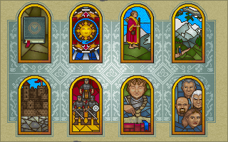

### The Hand

As you play, you will access a number of different ‘pages’ found within each Book of the Blood March. To be able to use any of the pages in a book you need to move and use the ‘hand’ which is controlled by your mouse. Simply move your mouse and the hand will move accordingly around the page. To ‘touch’ something on a page (and therefore elect to activate it), move the hand so that the index finger points to the relevant area, then press either the left or right mouse button. You will notice that as the finger passes over a page, helpful prompts appear to explain what the item beneath the finger does.

## The Index Page

From the Index page you can turn immediately to any of the available chapters. By moving the hand around this page and pointing at each picture, you can learn what each one does. If you touch one of the pictures, you are taken to a new chapter.

### The Almanac & Bestiary

Within the realms of the Blood March all manner of beasts and artefacts abound. Read this chapter to discover what peril or boon lies in store when you chance upon such things.

### The Map

Behold the Blood March and all its realms marked upon this chart.

### Heroes & Villains

Herein are revealed those men and women, fey and foul, dwarves and giants around whom the unfolding saga of the Blood March revolves.

### The Travellers Guide

In this chapter you will find all manner of places described, so that the traveller may find his way through the lands of the Blood March with more ease.

### Here & Now

In this chapter you play your part in the unfolding saga of the Blood March and the Dark Citadel of Maranor.

### Fellowships

Herein the Book of the Blood March lists those fellowships of diverse race with, under your Power of Command, seek to defeat Boroth the Wolfheart and return the Blood March to peace and harmony.

### The Chronicle

In this chapter, events of note in the story of the Blood March are recounted so that none may forget the mighty struggle against the evil of Boroth and the Dark Fey.

### The Alliance

In this chapter are pictured the heraldic devices of all those who have placed themselves under the Power of your Command to strive against the Dark Citadel of Maranor.

Each Chapter is described in more detail later.

In the bottom right corner of the Index page you will find a symbol which you will also see on almost all the other pages in the game:

Touching this open scroll symbol will give you help about the page you are on. A new symbol (resembling a closed scroll) will take you back to the Index when you have finished reading.

### The blue bookmark

Touching the blue bookmark will close the current book. You will be asked to choose from one of three options. Discarding the book will abandon any events that have taken place since you last wrote in it or since the last turning of midnight, and then exit the game. Closing the book will also exit the game but commit the events into the book first. Continuing the book will take you back into the quest, without making any changes. (Writing to the book is the same as saving your current position in the game).

### The green bookmark

This green bookmark will only appear if a game has been previously written into a book. When you touch this, you are taken to a new page which allows you to start a new book of your choice.

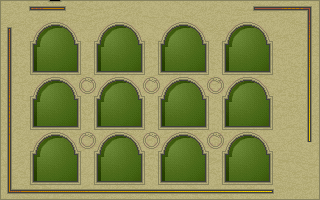

Touching a book will start the story afresh. Volumes already in use are indicated with a bookmark. The first time you play the game (immediately after installation) you will begin using the Black Book of the Blood March. If you touch a volume already in use you will restart the game from the beginning and lose whatever was recorded in the book. Only do this if you are absolutely certain! To continue with your current book, touch the open volume instead. This will take you back to what you were doing before.

### Dates & Seasons

You will notice that a new game always begins on the same equivalent date (based on the Calendar of the Blood March) to the date you actually start playing. For example, if you begin playing on August 10th the game will begin on the 10th day of Eaglemoon. You can learn more about the calendar if you refer to ‘The Chronicle’. The four seasons (Summer, Autumn, Winter & Spring) will come and go as the game progresses.

### Link the new book to your world’s time

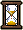

Touching this symbol starts the story afresh, linked to real-time. If more than one real day passes before you open the book again, the story will have moved on (see ‘Time Races On’ for more information). Note that once you have chosen this particular method of play, you cannot switch back to the standard method without touching the symbol again (free the new book of your world’s time) and starting afresh.

### The red bookmark

The red bookmark will only appear if you have started more than one book. It gives you the chance to open a different book whilst keeping the contents of the previously used volumes intact. This way you can load in a saved game position from a different game during play.

### Page symbols

Other pages use a common set of symbols that allow you to perform a number of new functions. Simply touch each symbol to use them.

This allows you to turn to the next available page. If you are on the last page, this icon will not be available.

As you might expect, this allows you to turn back to the page you were on previously. If you are on the first page, this icon will not be available.

The crystal ball will take you to a catalogue page if one is available. What is shown depends on the page you are on. You can then touch each catalogue entry and learn more about the chosen subject (Heroes & Villains, the Travellers Guide, or the Almanac and Bestiary).

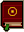

This book will take you immediately back to the Index page. Nearly every page in the Book of Blood March will have access to this symbol. It allows you to navigate the Book quickly and easily without becoming lost amongst the various chapters.

This appears in the top right corner of a page, and will allow you to turn to the chapter you were previously using. This allows you to navigate the book without having to go via the Index every time.

This symbol will appear whenever narrative text on a page is too long to fit on the page. Touch it to read more of the text. Each time you touch the symbol, one new line of text is revealed. Touch and hold down to scroll down through the text faster.

This symbol appears after you have touched the ‘Read more’ symbol. It allows you to look back at the earlier text on the page. Each time you touch the symbol, the text moves back one line. Touch and hold down to scroll up through the text faster.

## The Almanac & Bestiary

This chapter will reveal much information on a range of artefacts and beasts found in the realms of the Blood March. To choose a topic, use the ‘Next Page’ and ‘Previous Page’ symbols or touch the Crystal Ball to take you directly to a catalogue page where you can choose from all the subjects on offer. It is important to read what is on offer here; vital information learnt on these pages could save lives during the game. For example, the presence of wolves are [sic] a sure sign that the armies of the Dark Fey, loyal to Boroth the Wolfheart, are nearby.

## The Map

The map can be consulted at any time during the quest. You can use it to plot your next move, or keep an eye on the position of others as well as locate buildings, learn who controls them and spy on other landmarks.

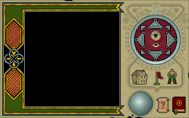

Pass the hand over the map and the name of each land will appear in the banner at the top. If the hand passes over any item, its name will be revealed above. Touching these features will then take you to a different page and allow you to read more about them.

To the right is a cluster of controls which allow you to scroll around the map in the eight main compass directions. As you move the hand over the compass, an eyeglass appears on the map. You can take a closer look at the map by touching the magnified eye in the centre of the compass controls.

Alternatively, you can see a broader view by touching the naked eye instead.

[map toggles ICON]

These three symbols reveal different features on the map. The first will show significant buildings (Castles and Citadels) and who currently holds them, the second shows those journeys set by quests, and the last shows all the known people by displaying their heraldic shields. To hide them again, touch the symbols a second time.

People and Buildings will only appear on the map when you know about them. You begin the game knowing the existence and location of each Citadel in the Blood March, and any Castles in the same or adjacent land to your characters [sic] starting positions. You will also know about the existence and location of the hostages and also the name of each ruler in the Blood March. To know a character’s location you need to have an Alliance member in the same or adjacent land to that character. They will then appear on the map, represented by their own heraldic shield.

Note that if you are currently showing people, the heraldic shields showing who holds each building will not be shown.

Your current character’s shield remains visible on the map at all times so you can easily locate their position. In this example you can see Prince Morkin’s shield, belonging to the Royal House of the Moon. Shields attached to buildings on the map indicate the current holder of the building (only when show buildings is on and show people is off). Whilst an individual may seize the building, the shield of the ruler to whom they currently owe allegiance is shown instead. Usually, this will be the ruler of their home realm, except when they belong to the Alliance. When that happens, their allegiance changes to Luxor the Moonprince. For example, if Rorthron the Wise seizes a Castle then the banner of the Royal House of the Moon will be raised above it’s [sic] battlements.

## How to get from A to B

You will learn how to create new quests later, but you should know that many of them will involve consulting the map and plotting new journeys that either lead to people or places. You will be prompted to touch your destination on the map, thus setting a journey which will be represented by a dotted line leading from relevant character’s current location to the new destination. There is another way of travelling from one place to another without using the map, and this involves taking control of the character. See ‘Here & Now’ for further details.

## Heroes & Villains

The first time you move to this chapter from the Index you will be taken immediately to Prince Morkin’s page. The narrative shown here tells you Morkin’s location, current quest, method of transport, how he is feeling and his personality. Mention will also be made of any warriors who are accompanying him on his journey, and any special artefacts that Morkin might possess. There are a number of symbols to be found on this page that need further explanation.

The symbol shows the character’s current quest. In this example, Prince Morkin is waiting for further instructions. For an explanation of all available symbols, see the section on ‘Making New Quests’. You cannot change the state of this symbol. It acts only as an indicator for the current quest.

This symbol indicates that the Book is taking heed of that character’s progress and is writing this into its pages for future reading. If the eyes are closed, then the book is not taking heed. You cannot change the state of this symbol either. It acts only as an indicator.

This symbol appears on pages of characters who are members of the Alliance. Touching it will open or close the eyes symbol above and change whether the current book is heeding their progress or not. If you are currently controlling the character then they are taken heed of automatically and this symbol will not be present.

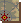

In the top right hand corner of this page you will find this symbol which will, when touched, take you to the map screen. This will show you where the current character is located within the realms.

Touching the character’s portrait allows you to give them a new quest. In this example, you would touch Morkin’s face found in the bottom left hand corner to open up the ‘Choose a quest’ window.

### New Faces

You also have access to the ‘Next Page’ and ‘Previous Page’ symbols here. They allow you to step through the pages for all the characters currently found on the Heroes & Villains catalogue. New faces will be added to this page as and when you learn about them. Whenever a member of the Alliance enters a new realm, they will learn about the characters in the same or adjacent lands. As a result, you will find their portraits added to the Heroes & Villains page.

### Making new quests

As you explore the realms you will learn about people, places and artefacts. Using the symbols available here, you can assign the various quests to other characters and let them follow your orders automatically. Whenever you make a new quest, the details are shown on that character’s page and the symbol above changes accordingly to reflect this.

When a character has been assigned a quest, you can either go to the ‘Here & Now’ and elect to ‘watch’ them carry out their instructions, or you can switch to another page or character and let them follow their quest whilst you get on with other tasks. As long as that character is being heeded, you will be informed of any events relating to their actions as the game progresses.

### Go to somewhere

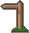

This allows you to send the character to a particular location on the map without needing you to take direct control. Touch this symbol to be taken to the map page. A row of dots will indicate the journey. If the character cannot reach the destination from where they are, you will be told. If the destination is acceptable, touch the portrait in the bottom right hand corner of the map page to confirm it. You are then taken back to that character’s page. Once the character has reached the destination, they will revert to waiting again.

If a character is tired en route, they will attempt to seek shelter and rest before continuing. Their quest will temporarily change to ‘seeking shelter’. Once refreshed and brimming with energy, they will revert to the original quest. If they cannot find any shelter, they will rest out in the open instead.

### Guard somewhere

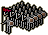

Again you can touch this symbol and then choose and confirm a destination on the map screen (as described in ‘Go to somewhere’). When the character reaches the destination they will stand guard and automatically attack if anyone or anything comes within close distance. Warriors posted into a garrison already guard buildings, so characters can only guard specific regions within the Blood March.

### Seize Stronghold

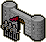

This will send the character to a building in the realms and then proceed to attack. Obviously it would make sense to have some warriors with them to ensure a better chance of success! (See ‘Recruiting Warriors’ for more details).

If the holder of the stronghold is not in residence, their Captain of the Guard will defend the building on their behalf. Once seized, the character will revert to waiting in the building for further orders. The flag of their ruler (either their Monarch, or Luxor if they belong to the Alliance) will then be hoisted above the battlements for all to see.

### Find something

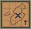

This symbol will take you to a catalogue showing all the ancient artefacts found within the Blood March. You can choose which artefact find by touching its symbol on the page. Your character will then attempt to find the artefact. It will either be lying around somewhere, or be in the hands of someone else. If the latter, Take something quest symbol will be available, and you should set a ‘Take’ quest instead. To conclude the find quest, your character will take the artefact once they have located it.

### Take something

This symbol will appear when an artefact is held by a character, as opposed to just lying on the ground somewhere in the Blood March. Choose the artefact you wish to take. Your character will then go off and find then take the artefact. This will usually involve a conversation (see ‘Talking’ for more details) in the first instance.

### Attack someone

Choosing this symbol will take you to a catalogue page showing a gallery of portraits. Now touch the portrait of the person you wish to attack. Your character will then attempt to locate and attack them.

### Join someone

This will take you to a catalogue page showing a gallery of portraits. Touch the portrait of the character you wish to join. Upon joining, you create a Fellowship. As a result, the character who was joined becomes leader of the Fellowship. (See ‘Fellowships’ for more details). However, if they are already in a Fellowship then your character will become a member of the same Fellowship.

### Recruit someone

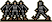

Again, touching this symbol will take you to a gallery of character portraits. Simply touch the face of the person you wish your character to try and recruit. Note that this is not the same as recruiting warriors to form an army. When you have succeeded in recruiting them, they will become part of the Alliance and may be influenced by the Moonring, allowing you to command and watch them. They are also automatically joined to the character who recruited them, forming a Fellowship. Not all characters will want to be recruited. Some may refuse your advances, usually for personal or political reasons.

### Destroy something

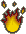

Touch this symbol then choose the artefact to destroy. Your character will then search the realms and when they have located the artefact, they will attempt to destroy it.

### Rescue someone

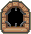

Touching this symbol will allow you to set a quest to rescue Luxor. If the character finds other hostages en route then they will also be rescued. A rescued character will be given a dragon to ride once they are free. The news of their escape will spread quickly across the realms and give the Alliance the chance to recruit more people to the war against Boroth. Rescued hostages will immediately head for their own realm and land within the Blood March. Only Arin Lord Blood and Corleth of Corelay can attempt to rescue Luxor, as they begin the game within the Dark Citadel. If they leave the Citadel, the rescue quest will become unavailable and the chance to rescue hostages (including Luxor) will be lost.

You can also directly Arin Lord Blood and Corleth of Corelay inside the Dark Citadel. If either of them encounters a hostage, approach the hostage and press F10 [sic] to enact the rescue.

### Shadowing someone

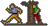

Choose the person you want to shadow (secretly follow) from the gallery of portraits. Your character will then locate the person and follow them from a discreet distance.

### Wait

Characters who haven’t been given a quest will wait by default. Similarly, Characters who have completed a quest will revert to waiting until a new quest is assigned to them. Impatient characters may go off on their own quests if they are left waiting too long!

Once a quest has been set by you, the character will begin to carry out their orders. If you change your mind about making a new quest, simply touch the character portrait in the bottom left corner again. This must be done before you choose a quest symbol, else you will have to go through the motions of setting a wait quest.

### Recruiting warriors

Point at the shield to the right of the character’s portrait. If it reveals you can transfer warriors, touch the shield. You will now be told their race, how many warriors are available and how many will rally to your cause. If there are any warriors available, touch one of the new shields that appear beneath this to begin recruiting.

### Warrior races

You can only have one race of warriors in your army at one time, but up to 8 different races can be posted at a building. However, you will not be allowed to post a race of warriors at a building if it already contains a race that they are feuding with elsewhere in the Blood March. To be able to choose which race to recruit from, you must not have any warriors with you when you touch the shield and begin the transfer process. For example, if you have an army of 200 warriors of the Free and you wish to recruit the 50 Kith at your nearest Citadel, you must first transfer your warriors of the Free into the garrison.

[SCREENSHOT]

Each time you touch the symbols on the right you will either recruit ten warriors to accompany you or transfer ten into the garrison. You may also find you have ‘less than ten’ warriors remaining at the end. They can also be transferred by touching the symbols. Strategically it’s not a good idea to leave a Citadel completely defenceless, so post some warriors at the Citadel just in case. To stop transferring warriors, touch the shield in the bottom left corner of the page again.

As time passes, new warriors will appear at Castles and Citadels throughout the Blood March, rallying to the flag of the current holder. Use the Map and the Travellers Guide to keep tabs on the number of new recruits that appear in buildings.

Warriors of the Free are in short supply in Midnight at the start of the game. Prince Morkin can only amass a large army of Free warriors once Luxor has been rescued from the Dark Citadel.

### Warrior numbers

A Warband consists of up to twenty warriors, whilst a Company totals between thirty and ninety. An Army is anything from one hundred warriors upwards.

### Becoming a character

By touching the animated 3d [sic] figure on this page you can immediately take control of the character in the ‘Here & Now’. This way you can take control of a character other than Prince Morkin. Note that you can only control those who have joined the Alliance and are therefore allies with Prince Morkin. Rescuing hostages will automatically make them members of the Alliance. Characters from the hostages [sic] realm will then become easier to recruit.

### Go to Fellowship

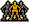

This symbol will be available if the character belongs to a Fellowship. Touching this symbol will take you to the Fellowship page where you can see who else has joined and who the current leader is.

## Travellers Guide

This chapter acts as a guide to the various locations you will come across when journeying the realms of the Blood March. You can either get here via the Index page, or by touching a building whilst on the map. The information available from these pages could prove to be very useful during the quest to defeat Boroth. For example, the current state of Castles and Citadels (who owns them, how many warriors guard them) is updated here. You can also learn more about the hostages and where they come from within the Blood March.

## Here & Now

In this chapter you play your part in the unfolding saga of the Blood March and the Dark Citadel of Maranor. From here you can take direct control of your current character and move them through the realms, talk to others, engage in battle, take artefacts, board ships, ride dragons and much, much more.

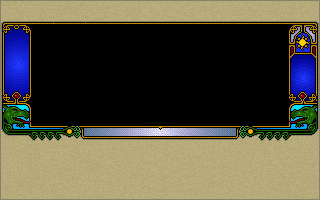

All this is possible thanks to the real-time, rendered, fractal generated landscape and the 3D texture mapped graphics system shown in the main window.

### Direct Control

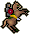

Touching the rearing horse symbol will put you straight into the action, directly controlling your character. How you control them depends on their current method of transport. A small map will appear below the main window, showing you the immediate surrounding area and detailing all major buildings and characters close by. Your current character’s heraldic shield will always appear in the centre of this map. Note that all the usual symbols will disappear from the panel below the main window whilst you are in direct control.

To quit from direct control, press the Escape key at any time.

### Methods of Transport

There are three basic methods of transport – on foot, by ship or by riding a dragon. You won’t be surprised to learn that ships can only traverse across water, and dragons can only fly. The advantage with dragons is the vast distances they can travel without having to worry about terrain, armies and other such obstacles.

### (i) On foot

This is the slowest way of moving across the realms. Apart from walking across land, you can wade through narrow rivers at a greatly reduced speed, but not through broad rivers or lakes. This is achieved by using your mouse when in direct control.

[mouse movement DIAGRAM]

Moving the mouse left or right will rotate your view through three hundred and sixty degrees. The compass strip beneath the main window will show your current heading. Forward and backward movement will adjust your viewing angle (looking up or down). To increase speed you need to click and hold down your left mouse button. The longer you hold it down, the faster you will move. Terrain will affect the speed at which you can travel on foot. Steep terrain will reduce the maximum speed you can move. To slow down you need to click and hold down your right mouse button. You can come to a complete halt by holding the right mouse button down until forward momentum in the landscape stops completely.

Tired characters will also move at a reduced speed when controlled directly. When watched or left on their own, characters will automatically take the opportunity to rest. If you continue to control a tired character, they will eventually collapse from exhaustion. They will be unable to move again until they have rested.

To enter a building your character must be as close as you can to the building walls, the press f4. If you try to enter a building that is held by an enemy, you will be told how many enemy warriors reside inside. If you want to try and seize the building, press F· (Attack building) whilst controlling a character, or set a ‘seize’ quest. Your character will have to fight the current holder or their Captain of the Guard. If you win, your character becomes the holder of the building, and their ruler’s flag will be raised. See ‘Fighting’ later on for more details.

### (ii) By ship

To sail a ship you must firstly locate and then board one by pressing function key f6 on your keyboard. Once onboard, control is the same as when you are on foot. To leave a ship, steer it to the shore then press f6 again. Characters cannot be recruited whilst they are onboard a ship.

[SCREENSHOT]

### (iii) By dragon

To ride a dragon you need to approach one and press f5. To make a dragon take off, you need to increase the speed (click and hold down your left mouse button) and also change the viewing angle so you are looking up into the sky (roll your mouse backward). To make it land, you need to reduce the speed to nothing (click and hold down your right mouse button) and look down towards the ground. Once landed, press f5 to dismount and proceed on foot.

Note that if your current character is the leader of a Fellowship and they ride a dragon, the Fellowship will be broken, [sic] (see ‘Fellowships’ for further details). If you have warriors under your command, they will lose heart and immediately disband if you ride a dragon. Common sense therefore suggests that you try and transfer them to a nearby friendly stronghold before you mount a dragon.

### Exploring indoors

You can only travel on-foot when inside a building. The control system remains the same, except that there is obviously no steep terrain to slow you down. F4 [sic] will make you leave the building you are in and return to the outside (with the exception of Luxor when he is still hostage inside the Dark Citadel). When outside, f4 will take you back inside a building if you are close enough.

Arin Lord Blood and Corleth of Corelay can be controlled directly whilst exploring inside the Dark Citadel of Maranor. If they come across a hostage, approach them and press f10. The hostage will then be rescued and spirited away on the back of a dragon, returning them to their respective homeland within the Blood March.

Luxor, Arin and Corleth might have to fight Troll guards inside the Dark Citadel. To fight indoors press the TAB key whilst under direct control (this does not include a ‘seize’ situation). They must get their strike in before their opponent does. Timing and positioning is important when fighting within the Dark Citadel. Stand too far away and your blow won’t make contact. Stand too close and you are likely to be hit, lose all your energy and wake up in a new cell somewhere else within the Citadel.

### Resting characters

All characters have to rest approximately once a day. This happens automatically when they are not controlled by you. If you switch to watch a character who is currently resting, they will continue their current quest until they are fully revitalised and brimming with energy. This will often involve seeking shelter until they are ready to move off again.

### Different views

Regardless of your method of transportation, you can change the view in the main window whilst you are directly controlling or watching your character. Simply press the number keys 1 to 6 on your keyboard. Key 1 to 5 will give you a variety of external views. Key 6 will always switch you back to the first person view through the current character’s eyes. Key 0 gives you a ‘fly by’ effect by locking the camera and allowing the character to move away. These different views are only available if your character is outside.

Touching the eyeball will allow you to watch your character from a remote view when outside. All the different views available are chosen automatically for you in this mode. If a character has been given a quest to complete, they will continue to follow out their instructions whilst being watched. You cannot watch a character when they are indoors, due to the Moonring’s inability to penetrate the evil power that emanates from the walls of the Dark Citadel.

To let time race on, touch this symbol. You will be taken to a new page which will allow you to advance time by hours or days, or indefinitely if you prefer. Important news regarding heeded characters will be brought to your attention as time advances. You will be given the chance to interrupt time and take control of the heeded character (touch their face), or ignore the news and let time race on some more.

To interrupt time racing on, press Escape.

### The Sun and the Moon

As you view the landscape through the eyes of your current character, you will see time pass. The Sun and the Moon will rise and fall across the sky to show the passing of another day. To help you approximate the time of day, you will find this symbol to the right of the main window. Behind the shutters you will find either the Sun or the Moon. Whether the shutters are opening or closing should help you to estimate the time of day or night. Alternately, keep an eye on the text box below the main window.

### Talking

To talk to other characters approach them from the front and move is as close as you can. Now press function key f1 to engage them in conversation. Your view in the main window will switch to show both characters. The conversation will then begin with opening greetings. A number of possible responses appear in a list below the main window, and you can touch the marker at the end of each line to use them.

[SCREENSHOT]

As in real life, some people will be quite willing to talk to you, whilst others will be reluctant. People who come from realms held to ransom by Boroth are unlikely to talk to you until their compatriot is free from captivity. Others may prefer the clash of steel, especially if they are not on your side. Boroth and his Dark Fey army will not stand for idle chit chat!

### Fighting

There will be times in the game when you will have to fight someone, using whatever weapon your character has to hand. Pressing function key f2 will announce your intention to fight your opponent. Both characters will then move into position. The fight will begin when the special panel appears below the main window. (If you manually control a ‘seize’, then you will also have to fight).

[SCREENSHOT]

The left side of the panel represents your opponent, whilst the right side is for your current character. Next to their respective portraits and heraldic shields you will find two rows of indicators. The swords represent the character’s strength/power, and the hearts show their state of health/energy. If either is reduced to nothing then that character will collapse and die! Strength will replenish between blows given time. In the middle of the panel you will also notice two small warriors in armour representing each character, and a larger warrior between them. The smaller figure show each character’s current move, whilst the middle warrior could be used to actually plan where on the body you will strike your opponent.

[targeting ICON]

Moving your mouse will highlight the individual arrows that point to this figure. This indicates the direction (aim) of your move. The shield at the bottom represents your defensive moves. The pertinant [sic] one will be selected for you, depending on the enemy’s attacking move. The shield also changes colour.

Red indicates that the move is available.

Green indicates that the move will be made when the left mouse button is clicked.

Yellow indicates the currently being executed.

You need to watch both the indicators on the panel and the action in the 3d [sic] above. Use the 3d [sic] to time your moves. If you make a defensive move before the enemy hits, then you will waste vital strength and the opponent is likely to hit you before you can change your move. You should initiate your defensive move just as your opponent is completing his previous move. This way you can anticipate the next blow and be ready. Similarly, make your attacking move when your opponent is completing his previous move and you should get your strike in first. If you notice their swords are depleting rapidly, hit them with a flurry of attacks to finish them off!

You do not have to directly control a fight. Assigning someone with an ‘Attack’, ‘Guard’ or ‘Seize’ quest then leaving them to carry out their orders will allow the outcome of the battles to be decided on your behalf according to each side’s relative strengths. You can always watch someone involved in a battle if you wish to witness the outcome first hand (or jump in immediately before the fight and take control).

### Army battles

If either character has a group of warriors in attendance, the fight will be representitive [sic] of a battle en masse. The number of swords and hearts available at the start will therefore reflect their collective strength as a unit, instead of just representing the individual combatants.

### Lucky blows

The outcome of any battle can be affected by an element of luck. The ability to land lucky blows means that winning a battle is not simply a matter of out-numbering your opponent. Surprise defeats for stronger armies are not as uncommon as you might think, as some characters are deemed to be luckier than others.

### Captains of the Guard

If you control or watch a fight when trying to seize a building, the current holder of the building might be elsewhere in the Blood March when you attack. You will therefore fight their appointed Captain of the Guard instead. The fighting procedure is the same as before, except that the monochrome portrait of your opponent shows for whom the Captain of the Guard is fighting on behalf of, rather than their own face.

### Taking and dropping artefacts

There are a few important artefacts to be found in the realms, like the widowmaker axe. To take them, move as close as you can then press function key f7 to swap weapons or f8 to swap artefacts. You can only swap items. You cannot drop an item without taking another to replace it. The narrative text on a character’s page will inform you of any artefacts that character may hold at the time. To swap items with a character, walk up to them then press f7 or f8.

### Using artefacts

Weapons (including special artefacts like the widowmaker) are used in combat simply by owning them.

### Graphic Detail adjustment

You can adjust the level of graphic detail if you find your computer is slowing down when displaying the 3d [sic] landscape. Users of slower machines may find this option useful. Simply pressing the Numeric + and – keys when watching or controlling someone in the 3d [sic] landscape will adjust the range that the landscape features are displayed within. At the lowest detail level, buildings and mountains will not appear in view until you are almost on top of them. As a result of this change, the speed of the 3d [sic] should improve. There are six different detail levels available.

## Fellowships

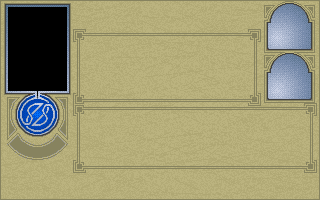

By giving a character a quest to join someone, you [sic] instructing them to are [sic] adopt that character as their leader. They will be under their command until the fellowship is broken. Whatever quest the leader is given, those characters who joined them will also follow the same quest. This includes following them when they are on the move (either by direct control or by a specific quest). This also applies to any warriors who belong to characters. Recruited characters will actually join themselves to whoever recruited them. Fellowships are a quick and easy way to assign the same quest to a large group of characters.

### Changing the leader

The Fellowship page show who the current leader is, and who are his followers. You can change the leader within a Fellowship by touching one of the small figures shown on this page. Note that whilst a character is following a leader you cannot control them directly. They either have to be assigned leader or the Fellowship must be broken before you can control them again.

You can switch between different Fellowships easily by using the Catalogue symbol and touching a different leader’s portrait on the Catalogue page. Alternatively you can use the ‘Next’ and ‘Previous’ symbol.

### Breaking a Fellowship

To break from a Fellowship, assign a follower a new quest. The leader can break a Fellowship if they do something that their followers cannot. For example, electing to ride a dragon will break a Fellowship because a dragon can only carry one person. However, boarding a ship will keep a Fellowship intact as there is enough room for all the followers to take passage on the same vessel.

## The Chronicle

In this chapter, events of note in the story of the Blood March are recounted so that none may forget the mighty struggle against the evil of Boroth and the Dark Fey. The narrative on the right recounts the day’s events. These will have been gathered from the exploits of Prince Morkin and all other characters who are being heeded.

A few unique symbols appear on this page that do not appear elsewhere in the Book of the Blood March.

### Make a copy of this book

[page being written ICON]

Touching this symbol will make a copy of the current book. This effectively allows you to save your position without quitting the game immediately afterwards. Note that your current game position is also saved automatically into the current book every midnight.

### Monthly Calendar

This symbol will take you to a page from the Blood March Calendar. Days that have already passed are illustrated with a blazing sun. Today is represented by blue cloudy skies and future dates are marked in black.

## The Alliance

This page shows the heraldic shields for each current member of the Alliance. At the start of the game you will only see six shields, representing Prince Morkin, Corleth of Corelay, Rorthron the Wise, Arin Lord Blood, Luxor the Moonprince and Araleth the White.

As characters are recruited and hostages are rescued, more shields will appear on this page. Touching a shield will immediately take you to the character’s ‘Here & Now’, where you can either watch or control them.

## Royal House Of The Moon Family Tree

[COMPUTER DIAGRAM]

## Customer Help

If you fill out your registration card and return it to us, you are covered by our warranty. If your disk should fail within 90 days due to manufacturing defects, return it directly to us for a free replacement. After 90 days, or if the disk was damaged through user or machine error, return the original disk(s) to us and enclose £2.50 for one disk and £5.00 for two or more disks. Please send a cheque in sterling, drawn on a UK bank and made payable to Domark Software Ltd.

Our Customer Helpline can be contacted on the following numbers:

Tel: 44(0)181-780 2224

Fax: 44(0)181-780 1540

Compuserve: 74431,1164

Internet: 74431,1164@CompuServe.com

## Credits

Programming by Mike Singleton, James Shaw, David Ollman, Paul Hodgson

Additional Programming by David Gautrey, George Williamson, Harvey Stroud, [sic]

Manual Design & Layout Andi Ewington  
Red Pepper Design

Product Managers for Domark

Matthew Woodley

Mark Gilbert

Producer for Domark

Dave Lee

Graphic Design by Andrew Elkerton, Stuart Flint

[sic]

Val Franco

Music by Paul Robotham

Executive Producer for Maelstrom

Hugh Batterbury

Manual copy written by Richard Hewison

The Lords of Midnight chronicles written by Mike Singleton

## Notes

## Notes

## Notes

[BACKCOVER]

Domark Software Ltd, Ferry House,

51-57 Lacy Rd, Putney,

London SW15 1PR

Tel: 44(0)181-780 2224

Fax: 44(0)181-780 1540

Compuserve: 74431,1164

Internet: 74431,1164@CompuServe.com

DOMARK [LOGO]

[MANUAL ENDS HERE]

## Reference Card

In this box you should find the main manual, this reference card, a letter to Prince Morkin from Rothron the Wise, the Lords of Midnight chronicles and your CD-ROM. If any of these items are missing, please consult with your software dealer.

### Installation and loading Instructions

### CD-ROM

To enter the realms of the Blood March you need to first install & then load the game. To install the game, insert the CD-ROM into your CD-ROM drive on your PC. Now log onto the drive as usual. For example, if your CD-ROM is designated as Drive E, type E: then press Enter. At the DOS prompt, type INSTALL then press Enter. Now follow the on-screen instructions. When installation is complete you will be returned to DOS. To run the game, type MIDNIGHT and then press Enter.

### Control devices

To use a mouse you need to have a Microsoft compatible mouse driver installed. If you run the game without a mouse driver, the game will assume joystick control. Throughout the main manual, mouse control is assumed. Joystick control is identical, except you are expected to use fire button 1 for the left mouse button, and fire button two [sic] for the right.

### Save game files

Whenever the game is saved, either automatically every Midnight or by you, the save game files are placed in a directory named after the colour of the current book. For example, the Black book of the Blood March will be saved into a directory named BLACK which is contained within the directory that the Citadel was installed to on your hard disk.

For any last minute changes please check for the presence of a READ.ME ascii text file on your CD-ROM. If there is no file, then all the requirements stated here are accurate at the time of publication.

## Dramatis Personae

Boroth the Wolfheart, High King of the Marish, King of the Dark Fey, steeped in centuries [sic] evil and bloodlust, who seeks to enslave all the realms of the Bloodmarch [sic] and the fair land of Midnight itself. The one who must be destroyed to save all.

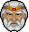

Luxor the Moonprince, Prince of Midnight, Lord of Xajorkith Prince of the Free, victor of the War of the Solstice against Doomdark and the war of the Icemark against Doomdark’s daughter, Shareth the Heartstealer. Luxor is being held to ransom by Boroth the Wolfheart in the dark Citadel of Maranor. Captured by Boroth following his shipwreck on the coast of the Marish during a voyage to Coromand in search of the magical jewel, the Eye of the Moon. Father of Prince Morkin and grandfather of Corleth of Corelay and, unbeknownst to him, Anderlane of the Arakai.

Prince Morkin, Lord of Corelay, Son of Luxor the Moonprince and husband of Tarithel the Fey, daughter of the Lord of Dreams, who has been given charge of Midnight during Luxor’s voyage to Coromand south beyond the Blood March. It has fallen upon Morkin to set forth into the Blood March to rescue his father from Boroth’s clutches and to destroy the Wolfheart: Morkin is the father of Corleth of Corelay and, unbeknownst to him, Anderlane of the Arakai.

Araleth the White, Lord of Dreams, Father of Tarithel the Fey and thus father-in-law of Prince Morkin, Araleth played a key part in both the War of the Solstice and the War of the Icemark and now stands ready at Morkin’s side to do battle against Boroth the Wolfheart and his Dark Fey hordes.

Rorthron the Wise, Guardian of the Tower of the Moon, One of the Wise, an ancient race of deep powers and knowledge, Rorthron has given counsel to Luxor in both the War of the Solstice and the War of the Icemark. Now, he is already deep within the Blood March heading for the Last Northing and the Crimson Mountains, having learnt that Prince Morkin has not just one son, Corleth of Corelay but a second son, Andelane of the Arakai, born out of wedlock, issue of Morkin and Shareth the Heartstealer but raised and nurtured in the Blood March by his surrogate mother, Cirithel of the Crimson Mountains. Rorthron suspects that Anderlane can offer invaluable help in the coming war against Boroth.

Corleth of Corelay, Lord of Thimrath Son of Prince Morkin and Princess Tarithel, grandson of Luxor the Moonprince and half-brother of Anderlane of the Arakai, Corleth had been accompanying his grandfather on the voyage to Coromand together with his friend, Arin. When they were captured by Boroth and taken to the Dark Citadel of Maranor, Luxor secured the release of the two boys by passing them off as servants. Now, however, Corleth and Arin have double-backed to the Citadel and, after finding a hidden entrance, they are at loose in the dungeons seeking to find and rescue Luxor.

Arin Lord Blood, Lord of Valethor Son of the Lord Blood who stood side-by-side with Luxor against Doomdark’s hordes during the War of the Solstice, Arin was accompanying his father on Luxor’s voyage to Coromand. After the shipwreck, his father Lord Blood was slain defending the unconscious Moonprince and Arin, now the new Lord Blood was taken prisoner together with his friend Corleth and the Moonprince. Now, with Corleth, he is armed and at large in the dungeons of Maranor, seeking to rescue Luxor.

Anderlane of the Arakai, Lord of the Crimson Mountains unsuspected grandson of Luxor the Moonprince, half-brother of Corleth of Corelay and son of Prince Morkin and Shareth the Heartstealer, Anderlane was conceived during the War of the Icemark whilst Morkin lay helpless under Shareth’s enchantments and, by Shareth’s magic, was born to a surrogate mother, Cirithel of the Crimson Mountains. There, in the Last Northing in the east of the Blood March, Anderlane was raised as though he were Cirithel’s own son. As yet, he knows nothing of his true origins but Rorthron suspects that he will play a key role in the coming war.

## Keyboard Summary

### Whilst controlling a character...

- `f1` — Talk to someone (when facing someone)
- `f2` — Attack someone (when facing someone)
- `f3` — Attack a stronghold (when near building)
- `f4` — Enter a building (when near building)
- `f5` — Mount or dismount a dragon (when near or riding a dragon)
- `f6` — Board a ship or go ashore (when near or on-board a boat)
- `f7` — Swap/Pickup a weapon (when facing a person or weapon)
- `f10` — Initiate Rescue (when facing a hostage)
- `Tab` — Interior combat against Trolls

### When controlling or watching a character...

- `Esc Halt` — Direct control/watching mode (also has the effect of pausing the game)
- `1-6` — Change camera views (outdoors only)
- `0` — Fix camera position for ‘fly by’ effect (outdoors only)
- `Num + and -` — Increase/decrease brightness level for dark monitors (indoors only)

Increase/decrease graphic level (outdoors only)

- `Num *` — Turns in-game music on/off

### Whilst time is racing on...

- `Esc` — Stop time racing on

### PC CD-ROM BONUS

You will find a couple of bonus programs included on the CD-ROM. They are PC conversions of the original 8-bit Sinclair ZX Spectrum prequels “The Lords of Midnight” and “Doomdark’s Revenge”. Read the ascii files MIDNIGHT.TXT and REVENGE.TXT on the CD-ROM for further instructions.

### PROBLEMS

If you experience any problems whilst trying to install or run The Citadel, please contact the customer help-line located in the back of your game manual.

[END OF REFERENCE CARD]
